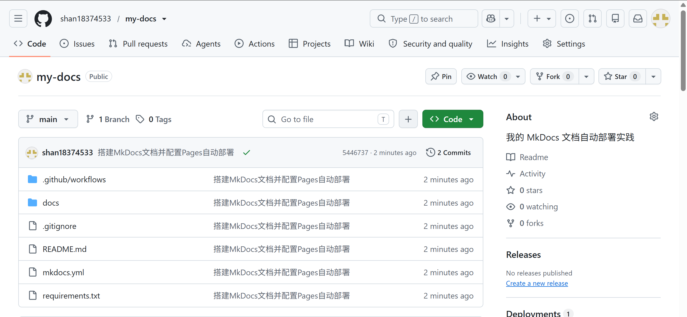
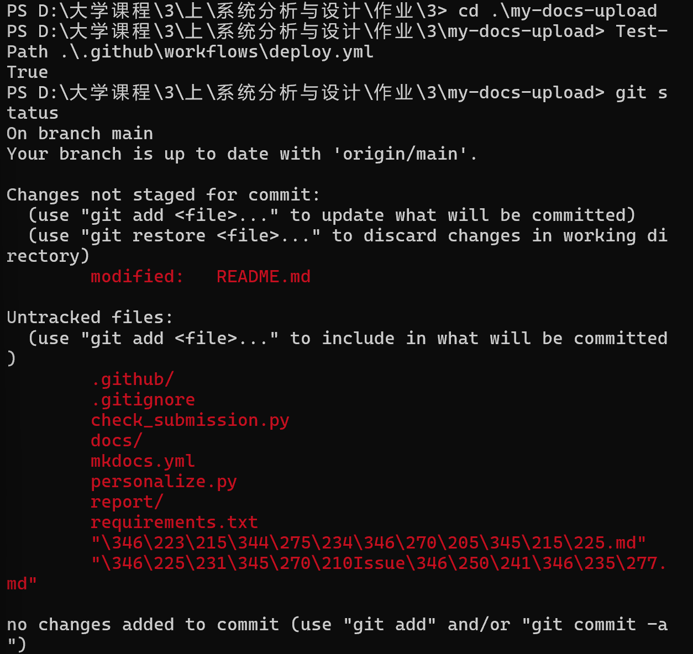
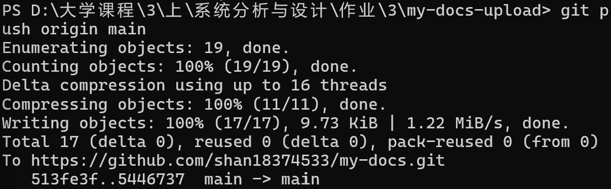
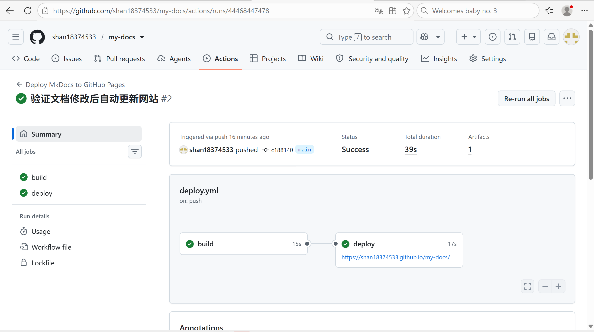
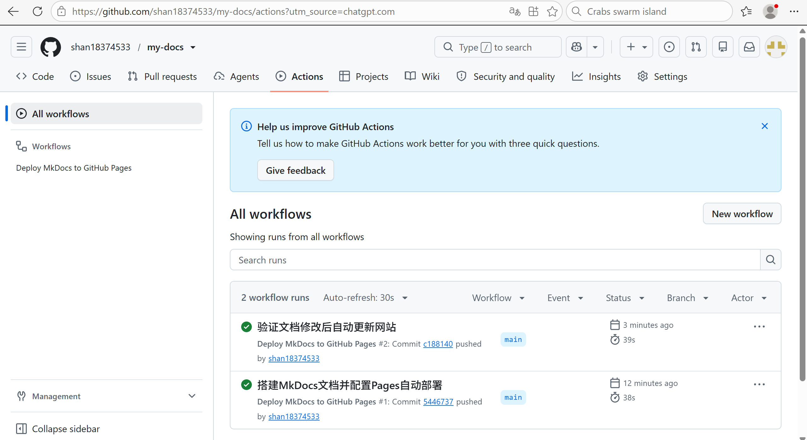

# 实践项目 2：个人实验报告

## 1. 基本信息

- GitHub 登录名：`shan18374533`
- 姓名拼音：`dengshan`
- 个人公开仓库：https://github.com/shan18374533/my-docs
- 最终网站：https://shan18374533.github.io/my-docs/
- 实验主题：基于 MkDocs 与 GitHub Actions 的静态文档自动部署
- 实验时间：2026 年 11 月

## 2. 实践过程与关键截图

### 2.1 个人公开仓库创建

**操作与目的：** 使用自己的 GitHub 账号创建 `my-docs` 公开仓库，确认仓库默认分支为 `main`。公开仓库既保存源码，也方便教师通过 URL 核对提交历史。

**实际结果：** 已使用账号 `shan18374533` 创建名为 `my-docs` 的 **Public** 仓库，默认分支为 `main`。创建初期的仓库首页能看到所属账号、仓库名和 `README.md`；随后将 MkDocs 项目文件推送到同一仓库。

### 2.2 文件结构与 MkDocs 配置

**操作与目的：** 在仓库中建立四页 Markdown 文档，并在 `mkdocs.yml` 里配置站点名称、网站地址、主题和导航。`docs/` 保存源码；`nav` 声明导航与页面的对应关系；`site/` 由构建命令自动生成，不作为日常编辑对象。

**实际结果：** 本地目录截图中能看到 `.github`、`docs`、`report`、`mkdocs.yml`、`requirements.txt` 等文件或文件夹；GitHub 仓库文件列表还显示 `.github/workflows`、`docs` 和 `mkdocs.yml` 已上传。公开网站导航包含首页、关于项目、使用指南和 API 参考四页。

提交前的 `git status` 显示部分文件尚未暂存；随后已完成 `git add`、提交和推送：

### 2.3 MkDocs 本地构建与检查

**操作与目的：** 在本地项目 `my-docs-upload` 目录中，使用 PowerShell 执行 `python -m mkdocs build --strict`，检查 MkDocs 能否根据 Markdown 源文件和 `mkdocs.yml` 配置生成静态网站。

**实际结果：** 本地命令成功执行，终端依次显示 `Cleaning site directory`、`Building documentation to directory` 和 `Documentation built in 0.79 seconds`。生成的网站文件位于项目目录下的 `site/` 文件夹，说明本次严格构建已完成。

构建过程中，终端显示了 Material for MkDocs 将于 **2027 年 5 月 5 日**结束维护的提示，并推荐后续了解 Zensical。该信息属于维护期限提醒，并未阻止本次构建成功。GitHub Actions 中的两次 `build` 任务也均成功，为网站部署提供了构建产物。

### 2.4 配置 GitHub Pages 发布来源

**操作与目的：** 在本人仓库的 `Settings → Pages` 中将 Source 设为 `GitHub Actions`。这样由自定义工作流直接上传静态资源并发布，不需另外维护 `gh-pages` 分支。

**实际结果：** 在 `shan18374533/my-docs` 仓库的 `Settings → Pages` 页面，`Build and deployment` 的 `Source` 已选择 **GitHub Actions**。未使用 Jekyll 或 Static HTML 的默认模板进行部署。

### 2.5 首次 Actions 构建与部署

**操作与目的：** 将项目推送到 `main`，打开 `Actions` 查看工作流。`build` 任务负责检出源码、安装依赖、生成并上传 `site/`；`deploy` 任务负责把已上传产物发布到 Pages。

**实际结果：** 首次将文档和工作流文件推送到 `main` 后，GitHub Actions 自动触发 `Deploy MkDocs to GitHub Pages #1`，最终显示 **Success**，其中 `build` 与 `deploy` 都成功。首次部署对应提交为 `5446737`，运行耗时约 38 秒。

- 第一次工作流运行链接：https://github.com/shan18374533/my-docs/actions/runs/44467393185

### 2.6 公开网站与导航检查

**操作与目的：** 打开 GitHub 实际给出的 Pages 网站地址，依次检查首页、关于项目、使用指南和 API 参考，确认导航、表格、代码块及内部链接可用。

**实际结果：** 公开网站地址为 https://shan18374533.github.io/my-docs/ 。已核对首页、[关于项目](https://shan18374533.github.io/my-docs/about/)、[使用指南](https://shan18374533.github.io/my-docs/guide/) 和 [API 参考](https://shan18374533.github.io/my-docs/api/) 均有可访问页面。页面包含导航、表格、代码示例和页面间链接。下面的真实截图保留了浏览器地址栏。

### 2.7 第二次推送与自动更新验证

**操作与目的：** 在 `docs/index.md` 新增一行本人编写的可辨认文字；提交并推送到 `main`，**不手动触发工作流**。随后核对：新的 Actions 运行由 `push` 触发、两个任务成功、网站刷新后能看到新增内容。

**第二次修改后新增的文字：** `自动部署验证：这是我在本次实践中新增的一条测试记录。`

- 对应第二次提交链接：https://github.com/shan18374533/my-docs/commit/c188140
- 第二次自动部署的 Actions 运行链接：https://github.com/shan18374533/my-docs/actions/runs/44468447478
- 网站显示新内容的结果：第二次运行由 `push` 触发，`build` 和 `deploy` 均成功；更新后的网页截图显示了上述新增文字。

## 3. 问题与解决

**问题一：最初没有在 Pages 页面找到发布来源设置。**

- **实际现象：** 初次点击 Pages 时进入了个人账户的 Pages 设置页，只看到 `Verified domains`，没有找到 `Build and deployment → Source`。
- **原因分析：** 个人账户的 Pages 设置与具体仓库的 Pages 设置不是同一个页面。
- **采取的操作：** 改为打开 `https://github.com/shan18374533/my-docs/settings/pages`，进入仓库自己的 Pages 设置页。
- **再次核查：** 页面显示 `Source: GitHub Actions`；随后首次及第二次自动部署均成功。

**问题二：提交前 `git status` 出现红色文件名。**

- **实际现象：** PowerShell 显示 `Changes not staged for commit`、`Untracked files`，其中部分文件以红色显示。
- **原因分析：** 文件尚未加入 Git 暂存区，并不代表发生编译或运行错误。
- **采取的操作：** 使用 `git add` 暂存所需网站源码和工作流文件，随后执行 `git commit` 和 `git push origin main`。
- **再次核查：** 推送命令成功，远程仓库显示了项目文件，Actions 中的部署记录显示成功。

## 4. 原理理解

**问题 1：`docs/` 和 `site/` 分别存放什么？为什么不手工修改 `site/`？**

`docs/` 存放 Markdown 源文件，是内容的维护入口；`site/` 存放 MkDocs 根据源码和配置生成的 HTML、CSS 等静态文件。再次构建可能覆盖 `site/` 的内容，因此应修改 `docs/` 而不是直接修改产物目录。

**问题 2：本次工作流在什么情况下自动运行？**

当有提交推送到 `main`，且改动命中 `.github/workflows/deploy.yml` 中 `push.paths` 的路径（如 `docs/**`、`mkdocs.yml`、`requirements.txt` 或工作流文件）时，GitHub Actions 会自动执行。`workflow_dispatch` 还允许手动运行，但不是第二次自动更新验收的替代方式。

**问题 3：`build` 与 `deploy` 两个任务有什么区别？**

`build` 负责取得源码、准备 Python 环境、安装依赖、执行严格构建并上传 `site/` 产物；`deploy` 在 `build` 成功后运行，使用 Pages 部署权限把产物发布为公开网站。构建成功不等于部署已经成功，两项状态都要核对。

**问题 4：只修改 `report/README.md` 会触发部署吗？为什么？**

不会。当前工作流明确设置了 `push.paths` 路径过滤，报告路径不在过滤列表里。这能避免只修改实验报告时重新构建一个内容未变的网站。若同时改了 `docs/` 等匹配路径，则仍会触发。

**问题 5：为什么本方案无需创建 `gh-pages` 分支？**

因为工作流采用 GitHub 官方 Pages Actions 发布方式：先上传 `site/` 构建产物，再用 `actions/deploy-pages` 发布。发布来源已经设置为 GitHub Actions，静态网页不必另外提交到 `gh-pages` 分支。

## 5. 实践收获

通过本次实验，我掌握了从编写 Markdown 文档到发布 GitHub Pages 网站的基本流程，也理解了 MkDocs、GitHub Actions 和 GitHub Pages 的分工。MkDocs 负责将 Markdown 转换为静态网页，GitHub Actions 负责自动执行构建和部署任务，GitHub Pages 则负责提供网站访问地址。

操作过程中，我一开始进入了 GitHub 个人账户的 Pages 设置页面，只看到了域名验证选项，没有找到网站发布来源。后来进入 `my-docs` 仓库自己的 `Settings → Pages` 页面，才正确设置了 GitHub Actions。这让我认识到个人账户设置和仓库设置的区别。

在本地使用 Git 时，`git status` 曾以红色显示一些修改过或尚未跟踪的文件。经过检查，我了解到这表示文件尚未进入暂存区，并不是程序报错。使用 `git add`、`git commit` 和 `git push` 完成提交后，仓库中的文件得到了更新。

印象最深的是第二次自动部署验证。我在 `docs/index.md` 中增加了一条测试记录，推送到 `main` 后，没有手动点击运行按钮，GitHub Actions 就自动执行了构建和部署。最终网站首页出现了新增的文字。这让我直观理解了“修改源码—推送代码—自动构建—网站更新”的全过程。

此外，我在本地运行了严格构建命令，看到网站文件成功生成，也学会了区分维护期限提醒和真正的构建错误。

我认为这种自动部署方式特别适合课程文档、学习笔记和开源项目说明。相比每次手工上传网页，只需维护 Markdown 源文件并推送修改，既方便更新，也可以通过提交记录和 Actions 日志追踪变化。
