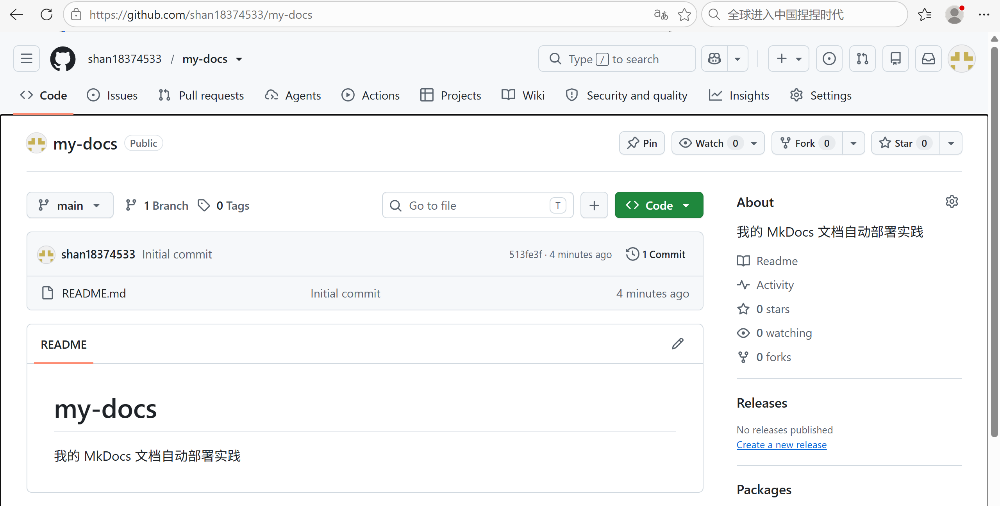
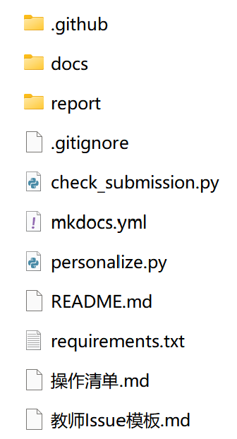
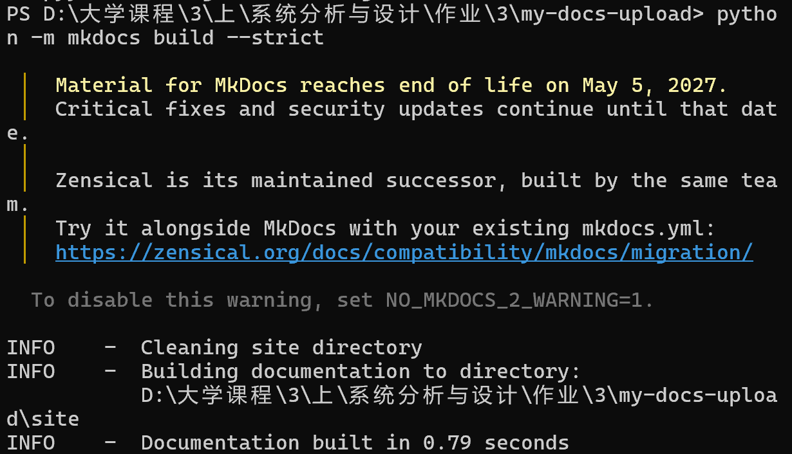
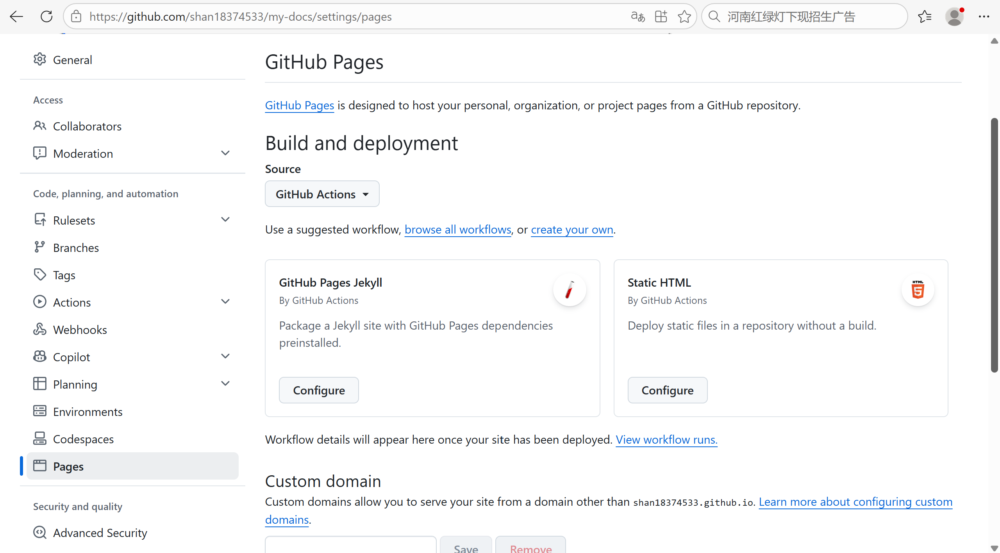
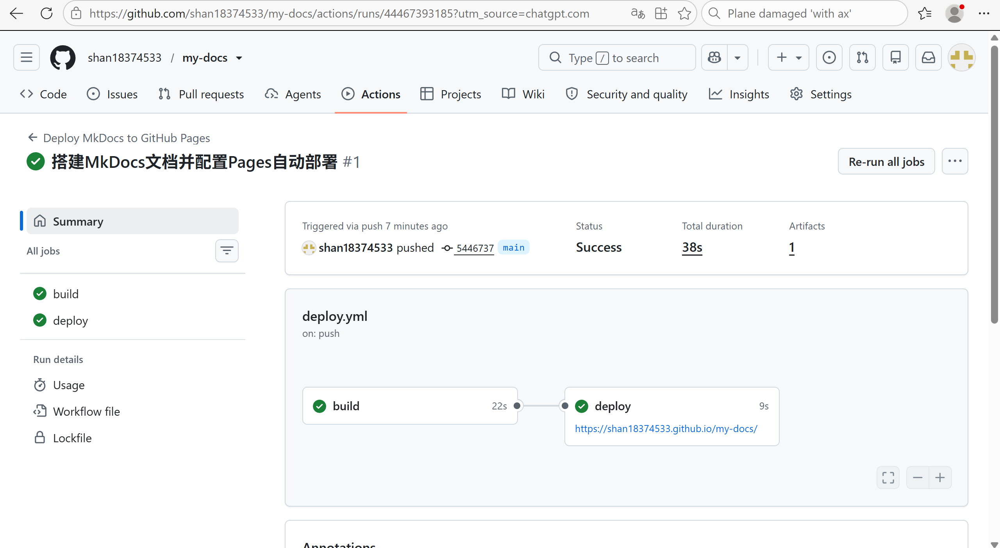
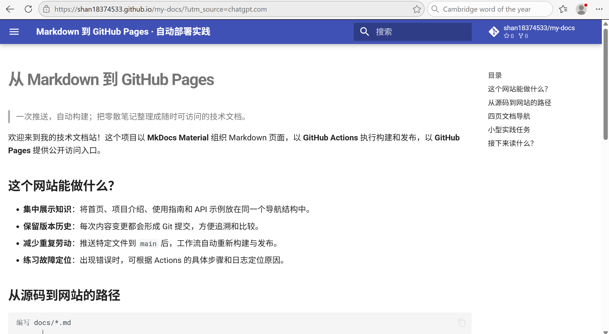
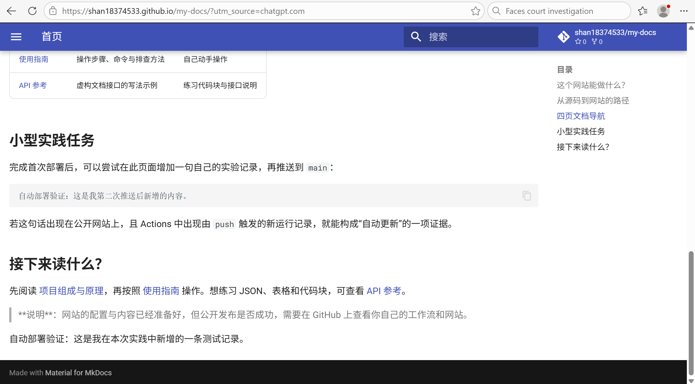

# 实践项目 2：个人实验报告

> **填写状态：待完成真实操作。** 下列“待填写”位置、实际截图和运行链接必须根据本人在自己账号上的操作补齐。不要把模板当成已经验证成功的实验报告。

## 1. 基本信息

- GitHub 登录名：`shan18374533`
- 姓名拼音：`dengshan`
- 个人公开仓库：https://github.com/shan18374533/my-docs
- 最终网站：https://shan18374533.github.io/my-docs/
- 实验主题：基于 MkDocs 与 GitHub Actions 的静态文档自动部署
- 实验完成日期：**待填写**

## 2. 实践过程与关键截图

### 2.1 个人公开仓库创建

**操作与目的：** 使用自己的 GitHub 账号创建 `my-docs` 公开仓库，确认仓库默认分支为 `main`。公开仓库既保存源码，也方便教师通过 URL 核对提交历史。

**实际结果：** 待填写——仓库名称、Public 标识、所属账号，以及截图所示内容。

### 2.2 文件结构与 MkDocs 配置

**操作与目的：** 在仓库中建立四页 Markdown 文档，并在 `mkdocs.yml` 里配置站点名称、网站地址、主题和导航。`docs/` 保存源码；`nav` 声明导航与页面的对应关系；`site/` 由构建命令自动生成，不作为日常编辑对象。

**实际结果：** 待填写——本地文件结构、四个页面名称、`mkdocs.yml` 配置是否完整。

### 2.3 本地严格构建与预览

**操作与目的：** 创建虚拟环境、安装 `requirements.txt` 中的依赖，再执行 `python -m mkdocs build --strict`。严格构建有助于及早暴露导航、链接或配置中的警告。使用 `python -m mkdocs serve` 检查网页显示效果。

**实际结果：** 待填写——实际运行命令、终端输出，以及首页/关于/使用指南/API参考四页是否全部检查。

### 2.4 配置 GitHub Pages 发布来源

**操作与目的：** 在本人仓库的 `Settings → Pages` 中将 Source 设为 `GitHub Actions`。这样由自定义工作流直接上传静态资源并发布，不需另外维护 `gh-pages` 分支。

**实际结果：** 待填写——Pages 页面显示的发布来源。

### 2.5 首次 Actions 构建与部署

**操作与目的：** 将项目推送到 `main`，打开 `Actions` 查看工作流。`build` 任务负责检出源码、安装依赖、生成并上传 `site/`；`deploy` 任务负责把已上传产物发布到 Pages。

**实际结果：** 待填写——`build` 与 `deploy` 两个任务的真实状态；若失败，记录错误日志及解决步骤。

- 第一次工作流运行链接：**待填写**

### 2.6 公开网站与导航检查

**操作与目的：** 打开 GitHub 实际给出的 Pages 网站地址，依次检查首页、关于项目、使用指南和 API 参考，确认导航、表格、代码块及内部链接可用。

**实际结果：** 待填写——浏览器实际网址、四页访问结果、资源加载情况。

### 2.7 第二次推送与自动更新验证

**操作与目的：** 在 `docs/index.md` 新增一行本人编写的可辨认文字；提交并推送到 `main`，**不手动触发工作流**。随后核对：新的 Actions 运行由 `push` 触发、两个任务成功、网站刷新后能看到新增内容。

**我实际新增的文字：** 待填写——请粘贴第二次推送的真实新增句子。

- 对应第二次提交链接：**待填写**
- 第二次自动部署的 Actions 运行链接：**待填写**
- 网站显示新内容的结果：**待填写**

## 3. 问题与解决

> 必须记录本人的真实情况；如果确实没有报错，说明自己检查过哪些日志与配置。请勿将下列示例当作实际经历。

- **实际遇到的问题或“无错误”检查记录：** 待填写
- **对应日志/现象：** 待填写
- **原因分析：** 待填写
- **采取的操作：** 待填写
- **再次核查的结果：** 待填写

**建议核对的配置：** 是否使用 `main`；`mkdocs.yml` 的 `site_url` 是否带仓库路径；`Settings → Pages` 是否选中 GitHub Actions；`build` 与 `deploy` 是否均成功；第二次工作流触发事件是否为 `push`。

## 4. 原理理解（可在操作后根据自己的观察完善）

**问题 1：`docs/` 和 `site/` 分别存放什么？为什么不手工修改 `site/`？**

`docs/` 存放 Markdown 源文件，是内容的维护入口；`site/` 存放 MkDocs 根据源码和配置生成的 HTML、CSS 等静态文件。再次构建可能覆盖 `site/` 的内容，因此应修改 `docs/` 而不是直接修改产物目录。

**问题 2：本次工作流在什么情况下自动运行？**

当有提交推送到 `main`，且改动命中 `.github/workflows/deploy.yml` 中 `push.paths` 的路径（如 `docs/**`、`mkdocs.yml`、`requirements.txt` 或工作流文件）时，GitHub Actions 会自动执行。`workflow_dispatch` 还允许手动运行，但不是第二次自动更新验收的替代方式。

**问题 3：`build` 与 `deploy` 两个任务有什么区别？**

`build` 负责取得源码、准备 Python 环境、安装依赖、执行严格构建并上传 `site/` 产物；`deploy` 在 `build` 成功后运行，使用 Pages 部署权限把产物发布为公开网站。构建成功不等于部署已经成功，两项状态都要核对。

**问题 4：只修改 `report/README.md` 会触发部署吗？为什么？**

不会。当前工作流明确设置了 `push.paths` 路径过滤，报告路径不在过滤列表里。这能避免只修改实验报告时重新构建一个内容未变的网站。若同时改了 `docs/` 等匹配路径，则仍会触发。

**问题 5：为什么本方案无需创建 `gh-pages` 分支？**

因为工作流采用 GitHub 官方 Pages Actions 发布方式：先上传 `site/` 构建产物，再用 `actions/deploy-pages` 发布。发布来源已经设置为 GitHub Actions，静态网页不必另外提交到 `gh-pages` 分支。

## 5. 实践收获（提交前请写自己的体会）

**待填写：** 请根据实际运行记录回答：自动部署与手动上传网页相比减少了哪些步骤？本次日志帮助你理解了哪些构建或部署问题？你认为这种方式适合哪一类项目？

## 6. 最终核对

- [ ] 本文中所有“待填写”均已补齐并核对事实
- [ ] 八张本人真实截图已放入 `report/images/` 且在 GitHub 上能显示
- [ ] 两次真实 Actions 运行可核对，第二次为 `push` 触发
- [ ] 网站四页可访问，第二次新增的内容已显示
- [ ] 已在教师仓库由本人提交一条符合格式的 Issue
